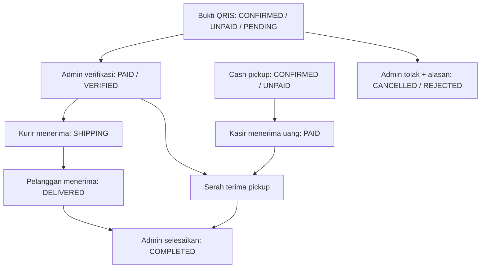

# SHAF STORE — Sistem Manajemen Toko AI-Native

Sistem manajemen toko **AI-native** untuk **SHAF STORE**, retailer produk **Apple**
(tanpa MacBook/laptop) dan **Samsung Galaxy seri flagship**. Pelanggan bisa memesan
lewat **chat AI di web**, **Bot Telegram**, atau **checkout langsung**; Owner mengelola
toko dengan bantuan tiga AI agent (Sales, Business Analyst, Action Assistant).

Proyek **capstone** yang disiapkan untuk dipakai operasional toko.

> Dokumen ini terdiri dari dua bagian: **Bagian A** = profil & proses bisnis SHAF STORE,
> **Bagian B** = sistem & engineering. Bagian A adalah rujukan faktual untuk penyusunan BMC.

---

# Bagian A — Bisnis SHAF STORE

## A.1 Tentang SHAF STORE

SHAF STORE adalah toko retail yang **hanya menjual produk Apple dan Samsung Galaxy
flagship**, beserta aksesori pendukungnya. Positioning: *spesialis iPhone, iPad &
Samsung Galaxy flagship* — bukan toko elektronik umum.

Toko beroperasi lewat dua kanal yang saling terhubung:

| Kanal | Keterangan |
|---|---|
| **Toko fisik** | Pembelian langsung, bayar tunai/transfer/QRIS, ambil barang di tempat. |
| **Online** | Web (`shafs-store.vercel.app`) dan **Bot Telegram** — konsultasi sekaligus pemesanan. |

**Lokasi & jam operasional:** _[alamat lengkap, kota, dan jam buka menyusul — mohon dikirim]_

## A.2 Produk yang Kami Jual

| Kelompok | Isi |
|---|---|
| **Apple** | iPhone, iPad, Apple Watch, AirPods, aksesori Apple |
| **Samsung Galaxy flagship** | seri **S**, seri **Z** (foldable), seri **Tab S**, **Galaxy Watch**, **Galaxy Buds** |
| **Aksesori pendukung** | casing (Spigen), charger & powerbank (Anker), kabel (UGREEN), screen protector — khusus untuk perangkat Apple/Samsung |

**Tidak kami jual:**

- laptop dan **MacBook** (semua merek)
- Samsung seri **A / M / F** (non-flagship)
- merek lain (Xiaomi, Sony, JBL, dan seterusnya)
- aksesori yang tidak spesifik untuk Apple/Samsung — MicroSD, SSD, kabel HDMI, flashdisk

## A.3 Cara Berbelanja

Tiga jalur:

1. **Chat AI di web** — tanya rekomendasi, bandingkan spesifikasi, cek stok dan harga.
   Untuk membeli, pelanggan diarahkan ke `/checkout`.
2. **Bot Telegram** — percakapan penuh sampai *Order Summary*, lalu konfirmasi pesanan
   langsung dari chat.
3. **Checkout web (`/checkout?item=<id>`)** — pilih produk, isi nama/telepon,
   tentukan penerimaan dan pembayaran, lalu konfirmasi tanpa daftar akun.

Ambil di toko mendukung Cash atau QRIS; pengiriman wajib QRIS. Untuk QRIS,
pembeli membayar nominal yang ditampilkan dan melampirkan screenshot transaksi
berhasil sebelum konfirmasi. Server menolak jika total berubah; jangan membayar
kedua kali, hubungi pengelola dengan bukti. Ringkasan chat mempertahankan price lock.

## A.4 Pembayaran

| Penerimaan | Pembayaran | Konfirmasi |
|---|---|---|
| Ambil di toko | Cash | Pesan dahulu, kasir menandai lunas setelah menerima uang |
| Ambil di toko | QRIS | Screenshot wajib sebelum konfirmasi; admin memverifikasi dana |
| Antar ke alamat | QRIS saja | Screenshot wajib; pengiriman baru setelah pembayaran terverifikasi |

Screenshot **tidak otomatis membuat lunas**. Bukti masuk ke detail transaksi admin
dengan nominal, data pembeli, tanggal unggah dan status PENDING. Pengelola mencocokkan
merchant, nominal, waktu serta dana masuk, lalu memilih verifikasi atau penolakan
dengan alasan. Bukti tersimpan privat di PostgreSQL, bukan URL publik.

Cash/legacy yang belum dibayar mengikuti batas pembayaran default 120 menit.
QRIS dengan bukti PENDING tidak otomatis kedaluwarsa saat menunggu pemeriksaan.

**QRIS resmi:** buka **Admin → Pengaturan toko & akun** (`/admin/settings`),
isi nama merchant sesuai aplikasi pembayaran dan unggah gambar QRIS resmi toko
(atau isi URL gambar). Pengaturan tersimpan di PostgreSQL, bukan `.env`.
Tanpa gambar atau nama merchant, checkout QRIS ditolak di semua environment;
Cash untuk ambil di toko tetap tersedia. Tidak ada simulasi QR, payment gateway,
atau verifikasi bank otomatis.

## A.5 Pengiriman & Pengambilan

| Cara | Keterangan |
|---|---|
| **Ambil di toko** | Siap diambil **kurang dari 1 jam**. Tunjukkan ID pesanan ke kasir. |
| **Kurir instan** | GoSend/Grab/dst, **dalam kota saja**. **Ongkir ditanggung pembeli.** |

Pengelola memperbarui **Belum dikirim → Dalam pengiriman → Diterima pelanggan**.
Tandai Dalam pengiriman setelah seluruh barang diserahkan ke kurir; tandai Diterima
hanya berdasarkan konfirmasi kurir/pembeli. Sistem tidak menebak penerimaan dari
waktu. Pesanan antar baru dapat diselesaikan setelah PAID dan DELIVERED. Setelah
pengiriman dimulai, pembatalan yang mengembalikan stok ditolak; retur/refund perlu
ditangani terpisah, bukan membatalkan barang yang masih berada di kurir.


## A.6 Harga

**Harga pas** — harga yang tertera sudah final dan sama untuk semua pembeli.
Tidak ada tawar-menawar, dan tidak ada harga grosir/reseller terpisah.

Harga dan promosi **dikunci saat konfirmasi pesanan**. Bila berubah di tengah proses
konfirmasi, pesanan ditolak dengan tagihan Rp0 — pelanggan tidak pernah ditagih lebih
dari yang ia lihat.

## A.7 Garansi, Keaslian & Barang Second

SHAF STORE menjual **barang baru (tersegel)** dan **barang second pilihan**. Status
garansi **berbeda-beda per produk** dan **wajib dicantumkan di tiap produk** —
selalu tanyakan sebelum membeli.

| Status garansi | Arti |
|---|---|
| **Garansi Resmi Indonesia** | Produk resmi distributor (iBox / Samsung Electronics Indonesia). Klaim ke service center resmi. |
| **Garansi Off** | Unit tanpa garansi (umumnya internasional). Dijual lebih murah, **tanpa** hak klaim. |
| **Garansi bertanggal** | Ada garansi sampai bulan/tahun tertentu (contoh: "garansi s/d Maret 2026"). Umum pada unit second atau sisa masa garansi. |

**Barang second/pre-owned** dijual dengan **grade kondisi yang jelas** dan mendapat
**garansi toko**.

> **Tampilan katalog:** informasi produk dan stok ditampilkan tanpa klaim bahwa
> semua unit tersegel atau bergaransi resmi. Status garansi tetap mengikuti
> informasi masing-masing produk.

## A.8 Purna Jual

Klaim garansi mengikuti status garansi pada tiap produk:

- **Garansi Resmi Indonesia** → service center resmi merek terkait.
- **Garansi bertanggal / garansi toko** → hubungi SHAF STORE selama masa garansi masih berlaku.
- **Garansi Off** → tidak ada hak klaim.

**Belum ditentukan** (mohon masukan sebelum dipakai untuk BMC): kebijakan retur/tukar,
refund, dan batas waktu komplain.

## A.9 Status Proyek

Proyek **capstone** yang dirancang untuk **dipakai operasional toko**. Sebagian integrasi
masih menyusul: payment gateway otomatis dan kanal WhatsApp. QRIS merchant dengan verifikasi bukti manual didukung.

---

# Bagian B — Sistem & Engineering

## 1. Ringkasan Arsitektur

```
                    ┌─────────────────────────┐
   Customer  ──▶    │  Web Chat Widget (FE)   │──┐
                    └─────────────────────────┘  │
                    ┌─────────────────────────┐  │   HTTPS/JSON
   Customer  ──▶    │  Bot Telegram (Bot API)  │──┤
                    └─────────────────────────┘  │
                                                 ▼
                                     ┌─────────────────────────┐
   Owner (Admin UI) ────────────────▶│  Nuxt Fullstack (satu    │
                                     │  origin :3000)          │
                                     │  /api/v1 (Nitro server) │
                                     │  ┌───────────────────┐  │
                                     │  │ channel adapters  │  │
                                     │  │ AI agents + tools │  │
                                     │  │ service layer     │  │
                                     │  └───────────────────┘  │
                                     └───────────┬─────────────┘
                                                 ▼
                                     ┌─────────────────────────┐
                                     │  Supabase (PostgreSQL)  │
                                     │  stok = agregasi txn    │
                                     │  audit_logs append-only │
                                     └─────────────────────────┘
```

**Prinsip keras:**

- **Checkout langsung tanpa akun** — pilih produk dan jumlah, isi data pemesan,
  lalu `POST /orders`. Chat/Telegram memakai Order Summary → konfirmasi eksplisit.
- **Stok tidak pernah kolom mutable** — selalu `SUM(inventory_transactions)` (view `v_product_stock`),
  pengecekan & pengurangan atomik dengan lock baris (`FOR UPDATE`) anti-oversell.
- **Satu rumus harga** — semua perhitungan harga/diskon (katalog, chat, checkout, admin) melewati
  `shared/utils/pricing.ts`: `discount_per_unit = round2(price × pct / 100)`,
  `unit_effective = max(round2(price − discount_per_unit), 0)`, `line_total = round2(unit_effective × qty)`.
  `price_at_order` = harga efektif per unit (net).
- **Price lock chat** — order ditagih sesuai `OrderSummary`; perubahan harga/promo
  ditolak `409 PRICE_CHANGED`, termasuk komposisi harga yang menghasilkan total sama.
  Checkout QRIS juga memeriksa nominal yang telah dibayar (`expected_total`);
  mismatch ditolak atomik sebelum menyimpan order/bukti atau reservasi stok.
- **Idempotency** — checkout web menyimpan digest rincian dan UUID, tanpa data
  pribadi, di sessionStorage. Server mengikat key ke pembeli/rincian/bukti dan
  mempertahankan replay transaksi direct; key bertabrakan ditolak. Key chat/Telegram
  tetap mengikuti TTL legacy. Retry tidak membuat bukti atau reservasi kedua.
- **Payment state terpisah** — order dibuat CONFIRMED/UNPAID. QRIS juga PENDING,
  baru VERIFIED/PAID setelah admin mengonfirmasi. Cash/legacy unpaid melewati deadline
  dibatalkan lazy; QRIS PENDING tidak otomatis dibatalkan selama pemeriksaan.
  **Hanya order `PAID` yang dihitung sebagai pendapatan** di analitik.
- **Identitas pembeli web = cookie guest server** — `shaf_sid` memisahkan pembeli
  anonim tanpa akun pelanggan; akses operator tetap memakai JWT terpisah.
- **Guard produksi fail-closed** — `server/plugins/00-assert-production.ts` menolak boot bila
  JWT secret default, `DEBUG=true`, `SEED_ON_STARTUP=true`, atau LLM/Telegram provider `mock`.
- **AI tidak pernah mengakses DB langsung** — hanya lewat tool → service layer.
- **Mutasi data hanya lewat jalur manusia/konfirmasi** — LLM tidak boleh membuat order atau
  mengaktifkan promosi; approval wajib Owner.

**Tech stack:** Nuxt 4 fullstack (Vue + Nitro server) · Drizzle ORM + Supabase PostgreSQL ·
Telegram Bot API · Groq/Qwen LLM. Backend Python lama sudah dihapus.

---

## 2. Struktur Repository

```
capstone/                     # Nuxt 4 FULLSTACK (satu-satunya aplikasi)
├── app/                       # Vue: pages admin + chat widget + storefront
├── shared/
│   └── utils/pricing.ts        # modul harga kanonik (dipakai FE + server)
├── server/                    # Nitro API /api/v1
│   ├── api/v1/                 # endpoint REST (auth, catalog, products, orders, chat, ai-actions, webhooks…)
│   ├── routes/                 # /health, /robots.txt, /sitemap.xml
│   ├── utils/                  # auth (jose/bcryptjs), business, agents, llm, telegram, summary, config
│   └── database/               # schema Drizzle + migrations SQL (DDL sumber kebenaran)
├── public/
├── drizzle.config.ts
├── nuxt.config.ts
├── package.json
└── .env.example               # satu-satunya env (FE + API)
```

---

## 3. Requirement Software

| Tool | Versi | Untuk |
|---|---|---|
| Node.js | 20/22/24 | Aplikasi (FE + API satu origin) |
| npm | 10+ | Package manager |
| PostgreSQL | Supabase (transaction pooler :6543) | DB |

---

## 4. Setup Environment

Satu `.env` untuk FE + API (tanpa Python):

```bash
cp .env.example .env         # lalu isi nilai asli (JANGAN commit .env)
npm install
```

Isi minimal di `.env` (lihat `.env.example` untuk daftar lengkap):

| Variabel | Wajib | Catatan |
|---|---|---|
| `DATABASE_URL` | ya | Supabase **transaction pooler** port **6543** (`postgresql://…`, tanpa `+asyncpg`) |
| `JWT_SECRET_KEY` | ya (produksi) | min 32 char acak |
| `IDEMPOTENCY_TTL_MINUTES` | tidak | masa berlaku idempotency key (default 30 menit) |
| `LLM_PROVIDER` | ya | `mock` untuk dev, `groq`/`openrouter`/`openai` untuk nyata |
| `GROQ_API_KEY` | bila `groq` | dari console.groq.com |
| `OPENROUTER_API_KEY` | bila `openrouter` | dari openrouter.ai/settings/keys |
| `TELEGRAM_PROVIDER` | ya | `mock` (dev) atau `bot` (Bot API asli) |
| `TELEGRAM_BOT_TOKEN` / `TELEGRAM_WEBHOOK_SECRET` | bila `bot` | dari @BotFather / string acak |

> **Penting:** dev boleh `LLM_PROVIDER=mock` dan `TELEGRAM_PROVIDER=mock`.
> `NUXT_PUBLIC_API_BASE` default `/api/v1` (satu origin) — **jangan** menaruh
> secret di variabel `NUXT_PUBLIC_*` (masuk ke bundle browser).

---

## 5. Database

DDL sumber kebenaran = **migrations SQL** (`server/database/migrations/`, dijalankan
berurutan); `server/database/schema.ts` hanya mirror Drizzle-nya.

```bash
psql "$DATABASE_URL" -f server/database/migrations/0001_init.sql            # tabel + view stok + trigger audit
psql "$DATABASE_URL" -f server/database/migrations/0002_product_image_url.sql
psql "$DATABASE_URL" -f server/database/migrations/0003_order_summaries.sql  # order_summaries (store ringkasan, TTL)
psql "$DATABASE_URL" -f server/database/migrations/0004_order_payment_state.sql  # payment_status/paid_at/expires_at
psql "$DATABASE_URL" -f server/database/migrations/0005_performance_indexes.sql  # index performa list admin & cleanup idempotency
psql "$DATABASE_URL" -f server/database/migrations/0006_payment_delivery.sql  # snapshot pembeli, bukti privat, review dan pengiriman
psql "$DATABASE_URL" -f server/database/migrations/0007_store_settings.sql  # identitas toko dan QRIS
psql "$DATABASE_URL" -f server/database/migrations/0008_product_gallery.sql  # backfill gambar lama ke galeri
psql "$DATABASE_URL" -f server/database/migrations/0009_admin_credentials.sql  # versi sesi admin
```

> **Tidak pakai `psql` (Windows tanpa client)?** Migrasi juga bisa dijalankan dari Node
> karena project sudah memakai driver `postgres`:
> ```bash
> node -e "const{readFileSync}=require('fs');const p=require('postgres')(process.env.DATABASE_URL,{max:1});(async()=>{await p.unsafe(readFileSync('server/database/migrations/0004_order_payment_state.sql','utf8'));await p.end();console.log('OK')})()"
> ```

Untuk Supabase yang sudah berisi tabel dari versi sebelumnya, jalankan hanya file
migrasi yang belum diterapkan. Jangan `drizzle-kit push` (bisa mengubah DDBB di
luar migrations).

### 5.3 Akun admin & katalog development

Akun admin disimpan di tabel `users`; kata sandi di-hash dengan bcrypt.
Tidak ada email/kata sandi default atau kredensial admin dalam `.env`.
Untuk instalasi baru, terapkan migrasi lalu jalankan dari terminal interaktif:

```bash
npm run admin:create
```

Masukkan email, nama admin, dan kata sandi (minimal 12 karakter, maksimal
72 byte UTF-8). Masukan kata sandi disembunyikan. CLI membaca koneksi database
dari `DATABASE_URL` / `NUXT_DATABASE_URL`; akun lama tidak diubah atau ditimpa.
Admin yang sudah ada tetap memakai kredensial database sebelumnya.

Setelah masuk, buka **Pengaturan toko & akun** untuk mengubah nama toko,
nama pemilik, gambar/nama merchant QRIS, serta email/kata sandi akun sendiri.
Nama pemilik di etalase terpisah dari nama profil admin. Perubahan email/kata
sandi wajib diverifikasi dengan kata sandi saat ini. Perubahan akun mencabut
sesi lama di semua perangkat; perangkat penyimpan mendapatkan sesi pengganti.
Token sebelum migrasi versi sesi tidak berlaku; masuk kembali setelah deployment.

`SEED_ON_STARTUP=true` hanya mengisi katalog demo **12 SKU** beserta stok
awal jika tabel produk kosong. Seed tidak membuat admin, pesanan, pelanggan,
atau promosi. `SEED_ON_STARTUP` wajib `false` di produksi.

### 5.3.1 Galeri gambar produk

Di **Admin → Katalog Produk**, tambah/ubah produk dan pilih beberapa gambar
sekaligus: maksimal **10 gambar**, JPG/PNG/WebP/GIF, **2 MB per gambar**.
Tentukan sampul, pindahkan urutan, atau hapus gambar lalu simpan produk.
Gambar pertama menjadi sampul katalog. Pembeli dapat menggeser galeri detail,
memakai tombol sebelumnya/berikutnya, thumbnail, atau keyboard ←/→/Home/End.
Gambar spesifikasi tampil utuh (object-contain), bukan dipotong.

API mutasi memakai `image_urls: string[]` berurutan. `image_url` pada response
adalah proyeksi sampul hanya-baca. Migrasi 0008 mempertahankan gambar produk
lama ke daftar baru sebelum menghapus kolom `image_url` yang lama.


### 5.4 Koneksi DB di serverless — transaction pooler, bukan session pooler

`DATABASE_URL` **wajib** memakai Supabase **transaction pooler** port **6543**.

Kenapa session pooler (5432) tidak boleh dipakai dari Vercel: mode session
mengalokasikan satu backend Postgres khusus untuk tiap koneksi client, dan
Vercel **membekukan lambda di antara request**. Saat beku, timer `idle_timeout`
driver DB tidak jalan, jadi koneksi tidak pernah dilepas. Tiap cold start menambah
slot baru sampai batas 15, lalu **semua** request gagal dengan:

```
PostgresError: (EMAXCONNSESSION) max clients reached in session mode
               - max clients are limited to pool_size: 15
```

`/api/v1/health` balas `503 degraded`, `/catalog/*` balas `500`. Transaction pooler
melayani banyak client dengan sedikit backend, sehingga lambda yang beku tidak
mengunci slot apa pun.

Prasyarat yang sudah dipenuhi kodenya (`server/utils/db.ts`):
`prepare: false` (wajib untuk transaction pooler) dan tidak ada fitur session-level
(temporary table, `LISTEN`/`NOTIFY`, `SET` per-session). Advisory lock yang dipakai
seed adalah `pg_advisory_xact_lock` — scope-nya transaksi, aman di transaction pooler.

**Melepas slot yang sudah terlanjur macet** (kalau pernah salah pakai port 5432):

```sql
-- jalankan via SQL Editor Supabase, atau psql dari transaction pooler
SELECT pg_terminate_backend(pid)
FROM pg_stat_activity
WHERE datname = 'postgres'
  AND application_name = 'Supavisor'
  AND state = 'idle'
  AND extract(epoch FROM (now() - state_change)) > 60;
```

Setelah itu periksa kembali: `SELECT count(*) FROM pg_stat_activity WHERE
application_name = 'Supavisor'` harus kembali kecil.

---

## 6. Menjalankan Aplikasi

Satu perintah — FE + API satu origin (tanpa backend Python):

```bash
npm run dev                   # http://localhost:3000 (API: /api/v1, health: /health)
npm run build                 # produksi (node-server; dipakai Vercel via preset vercel)
```

### Deployment

- **Satu deploy** → aplikasi Nuxt (FE + `/api/v1` + `/health`) + Supabase managed.
- **Vercel**: deploy repo root; set env di Environment Variables Vercel. **WAJIB
  pakai awalan `NUXT_`** — `NUXT_APP_ENV`, `NUXT_DEBUG`, `NUXT_SEED_ON_STARTUP`,
  `NUXT_DATABASE_URL`, `NUXT_SUPABASE_URL`, `NUXT_SUPABASE_SERVICE_ROLE_KEY`,
  `NUXT_JWT_SECRET`, `NUXT_LLM_PROVIDER=groq` + `NUXT_GROQ_API_KEY`,
  `NUXT_TELEGRAM_PROVIDER=bot` + `NUXT_TELEGRAM_BOT_TOKEN` +
  `NUXT_TELEGRAM_WEBHOOK_SECRET`, `NUXT_PUBLIC_SITE_URL`. Daftar lengkap ada di
  `.env.example`. `NUXT_PUBLIC_API_BASE=/api/v1` (default).
- Webhook Telegram → `https://<domain>/api/v1/webhooks/telegram` dengan header
  `X-Telegram-Bot-Api-Secret-Token` = `TELEGRAM_WEBHOOK_SECRET`
  (via `https://api.telegram.org/bot<token>/setWebhook`).
- Semua state penting (ringkasan order, dedup update Telegram, idempotency) ada
  di database — aman untuk lingkungan serverless tanpa state in-memory.
- **Region function mengikuti database.** `vercel.json` men-set
  `"regions": ["sin1"]` (Singapore) karena Supabase ada di `ap-southeast-1`.
  Tanpa ini, function Vercel jatuh ke region default (US East) dan tiap query DB
  bolak-balik antar benua — cukup untuk membuat semua aksi admin terasa lambat.

#### Latensi: kenapa aksi admin bisa terasa lambat

Waktu aksi admin = (jumlah query berurutan) × (RTT ke database). RTT ke
Supabase `ap-southeast-1` dari Indonesia ≈ 50-100ms, dan koneksi baru ke
transaction pooler butuh ±700ms lagi. Jadi yang dijaga adalah **jumlah round
trip**, bukan berat query-nya:

- `server/utils/db.ts` — `idle_timeout` 300 detik (bukan 20) supaya koneksi tidak
  dibuang saat admin diam >20 detik, lalu request berikutnya membayar koneksi
  baru.
- `server/utils/auth.ts` — `getCurrentUser` di-cache per token 60 detik,
  memotong 1 query di semua endpoint admin. Konsekuensi: perubahan status/role
  user baru terlihat maksimal 60 detik kemudian.
- `server/utils/products.ts` — hapus produk memakai CTE (beberapa `DELETE` dalam
  satu statement) dan agregat per order, bukan query per baris.
- Halaman admin memperbarui list dari balasan mutasi, tidak memuat ulang seluruh
  list setiap kali.

Untuk pengembangan lokal yang benar-benar cepat, pakai Postgres lokal
(Docker / `supabase start`) sebagai `DATABASE_URL` — tidak ada kode yang bisa
menghapus RTT jaringan ke Singapore.

#### Kenapa env Vercel harus berawalan `NUXT_`

Nitro hanya meng-override `runtimeConfig` dari environment variable berawalan
`nitro.envPrefix` (Nuxt menge-setnya ke `NUXT_`) **saat runtime**. Nama telanjang
(`DATABASE_URL`, `DEBUG`, `APP_ENV`, …) hanya terbaca kalau ada ketika `nuxt build`
berjalan — jadi nilai bake-nya ikut terpasang ke dalam `.output/server/`.

Konsekuensinya kalau pakai nama telanjang: mengubah env berarti **harus redeploy**,
Community plan membatasi jumlah build harian, dan preview build bisa memakai env
Production. Prefix `NUXT_` aman untuk kedua skenario. Nama `NUXT_PUBLIC_*` untuk
kunci yang memang harus masuk ke bundle browser.

Catatan: `serverConfig()` masih punya fallback `|| process.env.X` setelah
`useRuntimeConfig()`. Fallback itu berguna saat build, tapi karena `nuxt.config.ts`
selalu mengisi tiap kunci dengan nilai non-kosong, cabang `process.env` praktis
tidak pernah tersentuh saat runtime. Jangan andalkan dia — andalkan `NUXT_`.

---

## 7. Verifikasi

```bash
npm run build       # build produksi (client + Nitro server)
npm run lint        # ESLint (server + app + shared) — harus 0 error
npm run typecheck   # vue-tsc — menangkap undefined reference / typo import
npm run verify      # lint + typecheck (gate sebelum commit)
node .output/server/index.mjs # jalankan build, lalu:
curl http://localhost:3000/health
curl http://localhost:3000/api/v1/health
curl http://localhost:3000/api/v1/catalog/search?sort=termurah
```

> **`npm run typecheck` wajib dijalankan.** `npm run build` **tidak** melakukan
> typecheck — variabel/import yang hilang hanya muncul saat runtime (mis. `ReferenceError`).
>
| Kode typecheck | Arti | Contoh |
>|---|---|---|
| `TS2304` / `TS2551` | **Berbahaya** — nama tidak ada, pasti crash saat runtime | `promotions is not defined` |
| `TS2532` / `TS18048` | Ketidakpastian `undefined` (pola `.returning()[0]` Drizzle) | `'x' is possibly 'undefined'` |
| `TS2322` / `TS2345` | Ketidakcocokan tipe (mis. variant Badge) | `string` bukan union variant |

> **Status saat ini: 0 error lint, 0 warning, 0 error typecheck.**
>
> Yang sudah ditangani (jangan dibalik):
> - `noUncheckedIndexedAccess: true` (default Nuxt) membuat setiap `rows[0]` bertipe
>   `T | undefined`. Gunakan helper `firstRow(rows, ctx)` dari `server/utils/errors.ts`
>   alih-alih `rows[0]` — ia melempar error eksplisit kalau query kosong, bukan
>   `Cannot read properties of undefined`.
> - `DbLike` (`server/utils/db.ts`) menerima **koneksi maupun `tx`**. Deklarasikan
>   lewat `ReturnType<typeof getDb>` — `NonNullable<typeof _db>` menghasilkan
>   `never` dan membuat semua pemanggilan service error.
> - `bcryptjs@2` itu CommonJS: **wajib default-import** lalu destructure.
>   Named import lolos typecheck tapi crash saat runtime.
> - `app/components/ui/**` ada di ignore ESLint: komponen hasil generate
>   `shadcn-vue add` (bisa ditimpa CLI, dan `class?: any` memang disengaja).
> - **XSS di chat:** `marked` v5+ tidak lagi menyaring URL, jadi
>   `[x](javascript:…)` jadi `href` hidup pada `v-html`. `app/components/chat/MarkdownText.vue`
>   memakai renderer kustom (`safeUrl`) yang menolak `javascript:` / `data:` /
>   `vbscript:` — termasuk yang disamarkan dengan tab/newline. Escape-HTML saja
>   **tidak** menutup ini.
> - **Rate limit bersifat deterrent in-memory** (`server/utils/ratelimit.ts`):
>   per-instance, tidak lintas instance serverless. Jangan membalik ke pattern
>   "tabel DB 422 untuk semua endpoint mutasi publik" tanpa mengganti storage.
> - **Halaman admin Owner-only lewat middleware** `['auth', 'owner']` di semua
>   halaman kecuali Dashboard (`/admin` = landing aman untuk role lain; kartu
>   Owner-only di sana bersifat conditional `auth.isOwner`, bukan 403 toast).

Checklist smoke alur kritis: login Owner → katalog publik → chat start → message
(LLM) → order summary → confirm (price lock, idempotent replay saat retry) →
**cek `payment_status=UNPAID`** → **Mark Paid** → complete → cancel/restock →
produk/orders/promotions/inventory/customers/conversations/audit/analytics;
analyst ask (pastikan order UNPAID **tidak** masuk revenue); AI Action draft →
approve (EXECUTED) / reject. Plus: adjustment `quantity: -5` → 422 (bukan 500);
`idempotency_key` > 64 char → 422; hapus produk yang pernah muncul di chat → 409.

### Penyempurnaan UI pelanggan dan admin

- Storefront dan admin memakai navy–emas dari logo dengan canvas off-white yang sama.
  Header sticky hanya memuat masthead dan pencarian; offset anchor mengikuti tinggi
  terukur. Kategori navigasi dideduplikasi tanpa mengubah data database.
- Kartu produk memakai spesifikasi terstruktur yang sama dengan detail produk.
  Gambar yang kosong atau gagal dimuat memiliki fallback berlabel; CTA produk
  dan receipt memiliki target sentuh minimal 44 px. Tampilan ekstra sempit
  beralih ke susunan satu kolom agar teks dan kontrol tetap dapat dijangkau.
- Checkout memakai label, radio penerimaan native, error per-field dan fokus ke
  field pertama yang salah. Kontak yang ditolak validasi tidak mengirim pesanan.
  Checkout Cash mengirim JSON; QRIS mengirim multipart input JSON + screenshot privat.
- Chat mobile mendahulukan satu widget percakapan. Transcript memakai live log;
  status sedang mengirim terpisah dan jawaban tidak mengambil fokus input.
- Drawer/dialog admin menangani Tab, Shift+Tab, Escape dan pengembalian fokus;
  hanya dialog teratas merespons. Validasi stok/ambang menolak pecahan, bukan
  membulatkannya. Error simpan/upload tetap terlihat dan input tidak dikosongkan.
- Daftar/detail admin membedakan loading, gagal, kosong dan data; retry memakai
  pemuat yang sama. Append audit yang gagal mempertahankan kejadian sebelumnya.
  Dashboard role non-Owner menampilkan pembatasan, bukan angka nol palsu.
- QRIS merchant dikonfigurasi toko; demo berlabel. Screenshot diverifikasi manual oleh pengelola.

Verifikasi UI dilakukan pada aplikasi Nuxt aktual dengan fixture API in-memory
terpisah: viewport 320×740, 390×844, 768×1024 dan 1440×1000, navigasi keyboard,
reflow ekuivalen zoom 200%, validasi, error/retry, receipt, upload dan role STAFF.
Fixture tidak meneruskan request ke produksi; pengujian ini membuktikan perilaku
UI, bukan integrasi pembayaran, SQL atau transaksi database produksi.

---

## 8. API

| Area | Endpoint (prefix `/api/v1`) | Auth |
|---|---|---|
| Auth | `POST /auth/login`, `GET /auth/me` | publik / JWT |
| Akun admin | `PATCH /auth/account` | Owner; kata sandi saat ini untuk perubahan kredensial |
| Pengaturan toko/QRIS | `GET /settings`, `PATCH /settings` | publik / Owner |
| Katalog | `GET /catalog/search`, `/catalog/products`, `/catalog/categories`, `/catalog/:id` | publik |
| Checkout web | `GET /checkout/session`; `POST /orders` (JSON Cash / multipart QRIS) | publik (cookie guest server) |
| Order (manage) | `GET /orders`, `GET /orders/:id`, `POST /orders/:id/pay`, `…/cancel`, `…/complete`, `…/delivery` | Owner (JWT) |
| Bukti pembayaran | `GET /orders/:id/payment-proof` (binary private/no-store) | Owner (JWT), tidak menerima token pada URL |
| Chat / Sales | `POST /chat/start`, `POST /chat/:id/messages`, `POST /chat/:id/confirm` | publik (customer) |
| Analyst | `POST /chat/analyst/ask` | Owner (JWT) |
| AI Action | `GET /ai-actions`, `GET /ai-actions/:id`, `POST /ai-actions/draft`, `…/approve`, `…/reject` | Owner (JWT) |
| Produk | `GET/POST /products`, `GET/PATCH/DELETE /products/:id` | Owner (JWT) |
| Inventory | `GET /inventory/summary`, `GET /inventory/transactions`, `POST /inventory/adjustments` | Owner (JWT) |
| Promosi | `GET/POST /promotions`, `PATCH /promotions/:id` | Owner (JWT) |
| Pelanggan | `GET /customers`, `GET /customers/:id` | Owner (JWT) |
| Percakapan | `GET /conversations`, `GET /conversations/:id` | Owner (JWT) |
| Audit | `GET /audit/logs` | Owner (JWT) |
| Upload gambar | `POST /uploads/images` | Owner (JWT) |
| Webhook Telegram | `POST /webhooks/telegram` | secret token |
| Dev | `POST /dev/mock-tg`, `POST /dev/seed` | hanya saat `DEBUG=true` (**fail-closed**: default `false`) |

**Pencarian `q`** — endpoint daftar panel mendukung parameter pencarian:

| Endpoint | `q` mencocokkan |
|---|---|
| `GET /orders?q=` | potongan ID order ATAU nama/kontak/identifier pelanggan |
| `GET /customers?q=` | nama, kontak, ATAU identifier pelanggan |
| `GET /conversations?q=` | potongan ID percakapan ATAU identitas pelanggannya |

Filter dieksekusi di SQL (ILIKE + subquery), bukan diff di JS.

**Rate limit (anti-spam, in-memory per instance):**

| Endpoint | Batas | Kunci |
|---|---|---|
| `POST /auth/login` | 5×/15 mnt | IP + email |
| `POST /orders` | 10×/15 mnt | IP |
| `POST /chat/start` | 10×/15 mnt | IP |
| `POST /chat/:id/messages` | 20×/5 mnt | conversation id |
| `POST /webhooks/telegram` | sliding window (lihat §10) | chat id |

Lewat batas → `429` + header `Retry-After`.

**Konfirmasi order** — dua jalur resmi:

- **Cash web:** JSON `{items,customer:{name,contact,phone},fulfillment:{method:'PICKUP'},payment:{method:'CASH'},idempotency_key}`.
- **QRIS web:** multipart `input` berisi JSON yang sama dengan `payment.method='QRIS'`
  serta `expected_total`, dan satu file `proof` JPG/PNG/WebP maksimal 2 MiB/20MP.
  Gambar diperiksa signature dan decode pixel penuh. Pengiriman wajib recipient,
  phone, address. Rincian pembeli disnapshot per pesanan, bukan membaca nama lama.
- **Admin:** `/pay` memverifikasi bukti; `/cancel {reason}` menolak bukti pending
  dengan alasan dan mengembalikan stok. `/delivery {status:'SHIPPING'|'DELIVERED'}`
  memajukan status dengan timestamp dan audit; tidak ada transisi mundur/lompat.
- **Chat/Telegram:** ringkasan dan konfirmasi kanal tetap memakai kontrak legacy.

### Storefront terkini dengan logika checkout langsung

- Desain navy–emas, header sticky, katalog, filter, kategori dan promo tetap.
- Tombol Pesan/Beli sekarang membuka checkout langsung tanpa daftar akun.
  Akun pelanggan, keranjang dan quote tersimpan tidak lagi menjadi bagian aplikasi.
- Form checkout dinonaktifkan sampai hydration; data pribadi tidak dikirim
  melalui native GET saat JavaScript belum siap. Operator tetap masuk lewat `/login`.
- Sebelum deploy, terapkan migrasi yang belum dijalankan hingga **0009** secara berurutan. Akun dan gambar lama dipertahankan. Migrasi live tidak berjalan otomatis.

Pengujian menggunakan PostgreSQL disposable dan provider lokal, bukan `.env` toko:

```bash
docker desktop start --detach
docker pull postgres:17-alpine
node tests/helpers/storefront-runtime.mjs build
npm test
node tests/helpers/storefront-runtime.mjs development
```

Harness memakai port loopback dinamis dan mencetak URL lokal setelah siap.
Ketik `stop` atau Ctrl+C untuk menghentikan preview dan menghapus container miliknya.
Mode `production` memakai build dan guard produksi. Harness memakai direktori
build sementara terpisah agar tidak mengganggu server development yang sedang aktif.

Regression API/SQL mencakup reservasi unpaid, replay/concurrency, rollback,
persaingan stok, harga/promo terbaru, identitas guest, pembayaran/pembatalan/expiry,
konfirmasi ringkasan chat dan ownership Telegram. Smoke produksi memeriksa cookie
Secure dan kebocoran data pribadi pada SSR publik melalui transport HTTP loopback;
ini bukan bukti roundtrip cookie pada browser HTTPS produksi.
Verifikasi pembayaran/pengiriman (10 November 2026): lint, typecheck dan build
lulus; **24/24 pengujian** lulus tanpa skipped test. PostgreSQL disposable dipakai
untuk privasi bukti, validasi gambar, replay, nominal, rollback dan state pengiriman.
Browser aktual membuktikan DELIVERY hanya QRIS, bukti wajib/fokus validasi, gambar
bukti dan telepon sinkron ke admin, verifikasi manual, SHIPPING → DELIVERED →
COMPLETED, serta Cash pickup. Detail admin/checkout dan drawer pada 320 px tidak
overflow horizontal. Verifikasi historis tersebut memakai QRIS demo; versi terkini
menggunakan gambar merchant dari panel admin. Database transaksi toko tidak
dimigrasikan otomatis; sebelum deploy terapkan migrasi hingga 0009.

Verifikasi pengaturan/galeri: lint dan typecheck lulus; build deployment lulus.
Regresi `admin-settings-gallery` lulus (4 hasil), `payment-delivery` lulus
(8 hasil), dan smoke produksi lulus (2 hasil), tanpa skipped test. Migrasi
0008 terbukti mempertahankan gambar lama dan aman dijalankan kembali.
Browser aktual membuktikan login desktop/320 px, perubahan email/kata sandi,
unggah QRIS hingga terlihat di checkout, multi-file upload dan penggantian sampul,
tombol/thumbnail/keyboard serta gestur sentuh galeri. Panel pengaturan, login,
checkout, dan galeri ponsel tidak overflow horizontal. Media uji memakai provider
Storage lokal terisolasi, bukan bucket/QRIS/database transaksi toko.
CLI interaktif juga terbukti membuat admin pada PostgreSQL disposable; masukan
kata sandi tidak tercetak dan akun hasil CLI berhasil login (HTTP 200).


### Lifecycle order & pembayaran

`orders.status`, `payment_status`, `payment_review` dan `delivery_status` berbeda:



- **Expire lazy, bukan cron.** `expireStaleOrders()` dipanggil di awal `GET /orders`,
  `GET /orders/:id`, dan `GET /inventory/summary`. Aman di serverless (Vercel) tanpa
  Vercel Cron, dan idempoten. Order yang sudah dibayar tidak pernah disentuh.
- **Harga admin wajib > 0.** `POST /products` dan `PATCH /products/:id` menolak
  harga `0`, negatif, atau non-numerik (`422`) — harga kosong tidak pernah
  tersimpan sebagai Rp0.
- **`POST /orders` mengembalikan `expires_at`** (ISO) — batas bayar di UI dihitung
  dari server, bukan konstanta duplikat di client.
- **Analitik hanya menghitung `PAID`** (ekte bersama WHERE
  `payment_status='PAID' AND status IN ('CONFIRMED','COMPLETED')`) — dihitung di
  database. `to_date` berformat date-only (`YYYY-MM-DD`) diartikan AKHIR hari itu
  (inklusif), jadi rentang "1–31 Jan" mencakup tanggal 31.
- **Complete tanpa bayar ditolak** `409 NOT_PAID` — tidak ada jalan pintas
  mark-as-complete supaya analitik tidak menghitung revenue palsu.
- **Analitik hanya menghitung `PAID`** (`isCountableOrder`). Order UNPAID yang
  kedaluwarsa otomatis CANCELLED sebelum dihitung.
- `pay` idempoten: bayar ulang order yang sudah PAID tidak mengubah `paid_at`.

**Kode error order** (`data.detail.code`):

| Code | HTTP | Arti |
|---|---|---|
| `VALIDATION` | 422 | Input tidak valid (field wajib, format, range) |
| `INVALID_QTY` | 422 | Quantity bukan bilangan bulat positif |
| `PRODUCT_NOT_FOUND` | 404 | `product_id` tidak ada di katalog |
| `EMPTY_ORDER` | 409 | Tidak ada item untuk dipesan |
| `PRODUCT_INACTIVE` | 409 | Produk sudah nonaktif |
| `INSUFFICIENT_STOCK` | 409 | Stok kurang (`detail.available` = sisa stok) |
| `PRICE_CHANGED` | 409 | Harga/promo berubah sejak ringkasan dibuat (price lock) |
| `IN_PROGRESS` | 409 | Permintaan idempoten sama sedang diproses — retry nanti |
| `SUMMARY_EXPIRED` | 410 | `order_summary_ref` kedaluwarsa/tidak ada |
| `SUMMARY_MISMATCH` | 409 | Ringkasan bukan milik percakapan tersebut |
| `INVALID_STATE` | 409 | Transisi status order tidak sah (mis. cancel order COMPLETED) |
| `NOT_PAID` | 409 | `complete` order yang `payment_status` masih UNPAID |
| `ORDER_EXPIRED` | 409 | `pay` order yang lewat `ORDER_TTL_MINUTES` (belum di-expire) |
| `QRIS_UNAVAILABLE` | 503 | Gambar QRIS merchant belum dikonfigurasi di produksi |
| `PAYMENT_PROOF_REQUIRED` / `INVALID_PAYMENT_PROOF` | 422 | Bukti wajib atau gambar tidak valid |
| `PAYMENT_PROOF_TOO_LARGE` | 422 | Bukti melebihi 2 MiB |
| `EXPECTED_TOTAL_REQUIRED` | 422 | Nominal QRIS yang dibayar wajib dicantumkan |
| `IDEMPOTENCY_CONFLICT` | 409 | Key dipakai untuk pembeli/rincian/bukti berbeda |
| `DELIVERY_NOT_DELIVERED` | 409 | Barang antar belum dikonfirmasi diterima |
| `SHIPMENT_STARTED` | 409 | Pembatalan/restock setelah pengiriman dimulai ditolak |
| `PROMO_OVERLAP` | 409 | Promo aktif overlap untuk produk yang sama |
| `PRODUCT_IN_USE` | 409 | Produk dipakai order — nonaktifkan, jangan hapus |

---

## 9. Troubleshooting

| Gejala | Penyebab umum | Solusi |
|---|---|---|
| `DATABASE_URL belum diset` | `.env` belum ada / rebuild belum dilakukan | `cp .env.example .env`, isi, lalu `npm run build` ulang (env dibaca saat build) |
| Seluruh halaman & API balas `500` + header `X-Vercel-Error: FUNCTION_INVOCATION_FAILED` | plugin Nitro gagal boot — biasanya guard produksi menolak start | buka **Vercel → Logs**, cari `[config] GAGAL guard produksi:`; pesan itu mencantumkan seluruh env `NUXT_*` yang kurang. Set di Environment Variables (scope Production), lalu redeploy |
| `promotions is not defined` / `X is not defined` saat runtime | import hilang tapi build tetap hijau | `npm run typecheck` (atau `npm run verify`) |
| `DB tetap tidak terjangkau` saat request | `DATABASE_URL` salah / port bukan pooler | pakai Supabase **transaction pooler** port **6543** (lihat `.env.example`) |
| Semua request API `500`/`503` (`EMAXCONNSESSION`, `max clients reached in session mode`) | app memakai **session pooler :5432** + Vercel membekukan lambda, sehingga koneksi idle tidak pernah dilepas dan slot penuh di 15 | pindah `DATABASE_URL` ke **transaction pooler :6543**; lepas slot yang macet dengan `pg_terminate_backend()` (lihat §5.4) |
| Bot Telegram tidak membalas | webhook belum diset / tunnel mati | jalankan tunnel lalu `setWebhook` ulang (lihat §6 Deployment) |
| Konfirmasi chat ditolak `PRICE_CHANGED` | harga/promo berubah sejak ringkasan dibuat | desain begitu: ulangi pesanan untuk harga baru — 0 order tercipta, stok utuh |
| `SUMMARY_EXPIRED` saat konfirmasi | ringkasan > 30 menit (TTL `order_summaries`) | buat ringkasan baru lewat chat |
| Retry checkout | Hasil konfirmasi belum diketahui | kirim ulang **idempotency_key yang sama**; jangan mengganti produk/jumlah sebelum hasilnya diketahui |
| Server tidak mau boot setelah deploy | guard produksi menolak start | set `APP_ENV=production`, `JWT_SECRET_KEY` acak ≥32 char, `DEBUG=false`, `SEED_ON_STARTUP=false`, provider bukan `mock` — di Vercel pakai awalan `NUXT_` (lihat §6) |
| Telegram membalas `401` | `TELEGRAM_PROVIDER=mock` (webhook fail-closed) | pakai `POST /dev/mock-tg` untuk dev, atau set `bot` + `TELEGRAM_WEBHOOK_SECRET` |
| Login `429` | kena rate limit 5×/15 mnt per (IP+email) | tunggu 15 menit; counter direset otomatis setelah login sukses |
| `NOT_PAID` saat complete | order belum dikonfirmasi bayar | `POST /orders/:id/pay` dulu (atau tombol "Tandai Lunas" di admin) |
| Order UNPAID tidak ada di daftar | lazy expiry membatalkannya | buka `GET /orders` / `GET /inventory/summary`; order CANCELLED + stok kembali |

---

## 10. Keamanan

- **Jangan pernah commit `.env`** — hanya `.env.example` (sudah di `.gitignore`).
- **Guard produksi berjalan saat boot** (`server/plugins/00-assert-production.ts`) —
  menolak start bila `DATABASE_URL` kosong, `JWT_SECRET_KEY` masih default,
  `DEBUG=true`, `SEED_ON_STARTUP=true`, atau `LLM_PROVIDER`/`TELEGRAM_PROVIDER=mock`.
  Semua pelanggaran dikumpulkan dan dilaporkan **sekaligus** dalam satu pesan, jadi
  tidak perlu redeploy berulang hanya untuk menemukan env berikutnya yang kurang.
- **Deteksi produksi tidak lagi bergantung `NODE_ENV`.** `nuxt build` memaksa
  `NODE_ENV=production`, jadi memakainya sebagai fallback membuat build Vercel
  tanpa `APP_ENV` diam-diam menjadi mode production — guard menolak boot dan
  seluruh site balas `FUNCTION_INVOCATION_FAILED`. Sekarang: `APP_ENV` eksplisit,
  atau `VERCEL_ENV` untuk auto-deteksi (preview → `development`, production →
  `production`). Untuk lokal, `.env` dibiarkan `APP_ENV=development` supaya guard
  tidak menolak boot.
- **Env Vercel wajib berawalan `NUXT_`** — Nitro hanya meng-override `runtimeConfig`
  saat runtime lewat prefix tersebut; nama telanjang hanya ter-bake saat build.
  Detail di §6.
- **Webhook Telegram fail-closed** — tanpa `TELEGRAM_WEBHOOK_SECRET` (atau saat
  provider `mock`), `POST /webhooks/telegram` selalu `401`. Kalau `TELEGRAM_PROVIDER=bot`
  tapi token kosong, bot tidak bisa mengirim pesan dan webhook menolak semua update
  ( Intentional: fail-closed ). Simulasi tetap via `POST /dev/mock-tg` (DEBUG-gated).
- `audit_logs` bersifat **append-only** (ditegakkan trigger DB + service); aksi Owner
  atas produk/promo/stok/order ikut dicatat.
- `SUPABASE_SERVICE_ROLE_KEY`, `GROQ_API_KEY`, `OPENROUTER_API_KEY`, `TELEGRAM_BOT_TOKEN`, `JWT_SECRET_KEY`
  adalah secret backend — jangan kirim ke frontend.
- Webhook Telegram memverifikasi header `X-Telegram-Bot-Api-Secret-Token` secara
  **fail-closed** (lihat di atas).
- `POST /auth/login` dibatasi **5 percobaan / 15 menit per (IP + email)**; counter
  direset setelah login berhasil.
- Identitas customer web berasal dari cookie httpOnly `shaf_sid` yang diterbitkan
  server — client tidak bisa memilih `identifier` sehingga tidak bisa sengaja
  menyatukan order dengan session orang lain.
- Endpoint `/api/v1/dev/*` hanya aktif saat `DEBUG=true` — wajib `false` di produksi.
- Bukti pembayaran hanya dibaca lewat JWT Owner dengan `private, no-store`,
  tanpa URL publik. Gambar QRIS resmi dikonfigurasi merchant; bank tidak diverifikasi otomatis.
